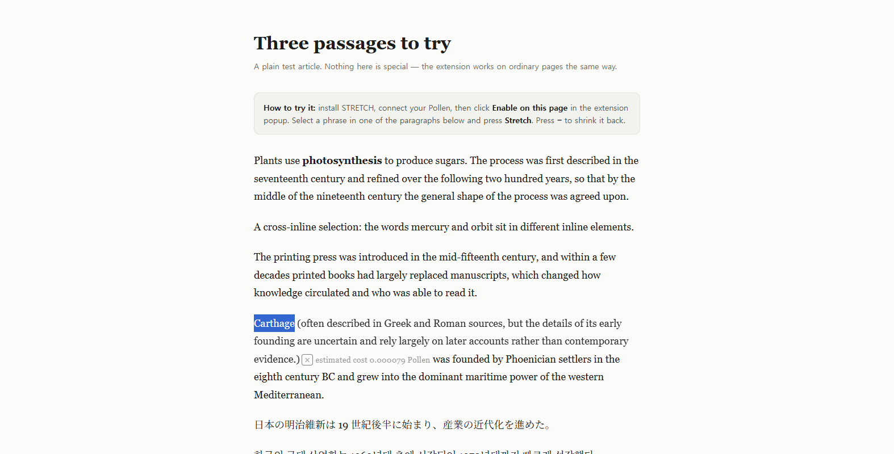

# STRETCH

**Stretchtext for ordinary web pages.** Select a phrase, click **Stretch**, and
the sentence grows a short inline addition right where you were reading — then
**×** shrinks it back. You pay with your own Pollen.

[](https://pollinations.ai/?ref=badge)

> In 1967 Ted Nelson described text that *grows* where the reader wants more and
> *shrinks back* where they don't. Writing every level by hand was too much
> work, so it never caught on. Generated text makes it cheap.

Quest: [pollinations/pollinations#17998](https://github.com/pollinations/pollinations/issues/17998)



*The real extension on the demo article: "Carthage" is selected, the addition grows
inline in the paragraph, and the `×` control shrinks it back. The original wording
is untouched.*

---

## Install (unpacked, no store)

1. Download `stretch-0.1.0.zip` from the [install page](https://patbing.github.io/stretch/).
2. Extract it.
3. Open `chrome://extensions` → enable **Developer mode**.
4. Choose **Load unpacked** and select the folder that contains `manifest.json`.
5. Pin **STRETCH**, open the popup and choose **Connect your Pollen**.
6. Open a page, click **Enable on this page**, select a phrase, click **Stretch**.

No build step, no dependencies, no account of ours. The ZIP contains only the
extension source.

## What it does

| Step | What happens |
|---|---|
| You select a phrase (1–600 characters, one paragraph) | A small **Stretch** button appears next to the selection |
| You click it | The phrase's sentence grows an inline addition in the page, in the page's own font |
| You click **−** | The addition disappears; the original wording is untouched |
| You click **Stretch** again | The cached addition comes back — **no new request, no new cost** |

The original text is never rewritten or wrapped. STRETCH appends one
extension-owned inline element at the end of the selection and removes exactly
that element on shrink.

## How it uses Pollinations

The whole integration is one request to the Pollinations API, made by the
service worker with the reader's own key:

```js
// background.js
const res = await fetch("https://gen.pollinations.ai/v1/chat/completions", {
  method: "POST",
  headers: { "Content-Type": "application/json", Authorization: `Bearer ${token}` },
  body: JSON.stringify({
    model: "openai/gpt-5.4-nano",
    messages: [
      { role: "system", content: SYSTEM_PROMPT },          // lib/prompt.js
      { role: "user",   content: buildUserMessage({ selection, before, after }) },
    ],
    max_tokens: 1200,
    stream: false,
  }),
});
```

| What | Where |
|---|---|
| API call, BYOP key, device flow | [`background.js`](background.js) |
| System prompt + user-message template | [`lib/prompt.js`](lib/prompt.js) |
| Model allowlist, tier-eligibility check, output validation, pricing | [`lib/validate.js`](lib/validate.js) |
| Sign-in (device flow) | [`connect.js`](connect.js) / [`connect.html`](connect.html) |
| The page-side behaviour | [`content.js`](content.js) |
| Price sheet + model list | `GET https://gen.pollinations.ai/v1/models` |
| Sign-in endpoints | `POST https://enter.pollinations.ai/api/device/code` · `POST https://enter.pollinations.ai/api/device/token` |
| Quality gate (20 fixed selections) | [`quality/quality.mjs`](quality/quality.mjs) — **20/20** |

The screenshot above is a real run: the addition in the paragraph is the
model's answer, produced by the call above.

## Models and cost

Only two models are ever called, and both are usable with **Quest (tier)
Pollen** — so a reader who has never paid anything can try it:

| Name | Model id | Input / 1M | Output / 1M | Measured |
|---|---|---:|---:|---|
| **Nano** (default) | `openai/gpt-5.4-nano` | 0.15 Pollen | 0.9375 Pollen | 2–13 s, 20/20 usable additions |
| **Flash** | `deepseek/deepseek-v4.1-flash` | 0.15 Pollen | 0.60 Pollen | 9–22 s (it reasons first), richest prose |

A typical stretch (≈1,500 input + 400 output tokens) costs **≈0.0005 Pollen**;
a heavy one (≈9,000 input tokens) is **≈0.0016 Pollen**. The popup shows the
estimate, and after each call the inline cost is the **estimated cost computed
from the token usage the provider reported** — not a guaranteed maximum.
Cached re-expansions make no request at all.

Prices are read from `GET https://gen.pollinations.ai/v1/models` when you
connect, and the extension **only calls a model that the live catalogue
currently reports as `paid_only: false`** — a model that is missing from the
catalogue, or that has become paid-only, is dropped from the picker and is
never called.

### Measured deviations from the design

The design consult proposed three things that measurement changed. They are
deliberate, and the numbers are in [`quality/quality.mjs`](quality/quality.mjs):

| Design said | We ship | Why |
|---|---|---|
| Flash is the default model, Nano the alternative | **Nano** is the default | Flash reasons before it answers: 9–22 s, and at a 400-token cap it returned an *empty* answer 14 times out of 20. Nano: 20/20 in 2–13 s. |
| 400-token request cap | **1,200** | Reasoning models spend that budget on thinking and return nothing. At 1,200 the same set passes 20/20. |
| The system prompt verbatim | verbatim **plus one line** — "Do not restate the selection and do not begin with the selected words" | Without it the model often re-stated the selection instead of adding to it. The line is in [`lib/prompt.js`](lib/prompt.js). |

## What was verified, and how

| Check | Result | Where |
|---|---|---|
| Unit tests (no dependencies) | **40/40** | `npm test` |
| Behaviour in a real Chrome | **10/10** | `tools/verify.mjs` — scrolled page, cache with no second request, the reader's model honoured, no trace left after a failure, a selection crossing inline elements |
| Quality gate (20 fixed selections) | **20/20** | `quality/quality.mjs` — terms, compressed claims, negation, uncertainty, technical prose, English/Japanese/Korean |

The behavioural checks drive the real extension in a real Chrome through the
DevTools protocol, so they cover what unit tests cannot: the floating button,
the inline insertion, the cache, the model choice and the failure path.

## Your Pollen, your key

STRETCH never holds a shared key and never proxies your traffic.

1. The popup opens a **Connect your Pollen** tab.
2. That tab requests a device code from Pollinations and shows it.
3. **Authorize at Pollinations** opens `enter.pollinations.ai/device` in a normal tab.
4. The tab polls every 5 s until you approve; the service worker stores the
   `sk_…` key in `chrome.storage.local`.

* The key is stored in your browser profile's local extension storage, in an
  area that is **restricted to extension contexts** (`TRUSTED_CONTEXTS`), so a
  content script cannot read it. It is **not** encrypted at rest.
* Authorized keys normally expire after 7 days and can be revoked sooner.
* **Disconnect** in the popup clears the local key. To invalidate it
  everywhere, revoke it at Pollinations.
* The key is never sent to the content script, never placed in the page, never
  written to `localStorage`, and never included in a log.
* Only a page may ask for a generation, and only the extension's own pages may
  run the privileged commands (connect, disconnect, change model). The worker
  ignores any model a page tries to choose.

## Privacy

* The request contains **only** the selected text (1–600 code points) plus up to
  1,000 code points of context from the same paragraph, before and after it.
* No URL, no page HTML, no cookies, no telemetry, no error reporting uploads.
* Generated additions are inserted into the page, so **the site can see them**.
  Shadow DOM is not a confidentiality guarantee.
* See [PRIVACY.md](PRIVACY.md).

## Known limits (v1, on purpose)

* Top-level document only — iframes and shadow DOM are not supported.
* Selections must stay inside one paragraph. Editors, inputs and textareas are
  never modified.
* No Firefox build, no store listing, no sync, no account system, no telemetry.
* "Works on any page" means "works across ordinary websites" — browser-internal
  pages (`chrome://`, the Web Store, PDF viewer) block extensions by design.

## Development

```bash
npm test            # node --test  — 43 unit tests, no dependencies
python tools/make_icons.py   # regenerate icons/ (stdlib only)
```

The extension is plain JavaScript with no bundler and no framework:
`manifest.json`, `background.js` (service worker — owns the key and the API
calls), `content.js` (the only file that touches the page), `popup.*`,
`connect.*`, and `lib/` (pure, unit-tested prompt and validation logic).

## License

MIT
